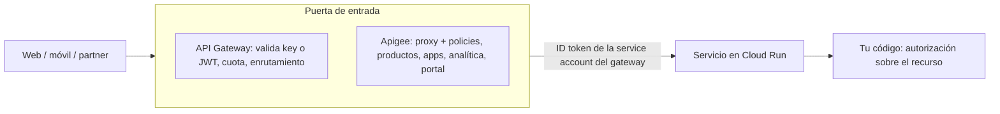

Tu backend corre en Cloud Run. La web y la app móvil lo llaman con access tokens, y nadie ha pensado en un gateway. Entonces ventas cierra el primer acuerdo con un partner. El partner necesita una key, un rate limit y un contrato que diga "10.000 llamadas al día". En la reunión alguien propone "pongamos Apigee delante". Otro responde "API Gateway es más barato".

Los dos son productos de Google Cloud que se colocan entre los clientes y tus servicios, así que parecen intercambiables. No lo son. **API Gateway** es una puerta de entrada gestionada: valida quién llama, aplica una cuota simple y enruta a un backend serverless. **Apigee** es una plataforma de gestión de APIs: trata tu API como un producto, con consumidores, planes, analítica, portal de desarrolladores y, si quieres, facturación.

Si eliges Apigee cuando solo necesitabas una puerta de entrada, pagas cientos de dólares al mes antes de la primera petición, además de una capa de proxies que tu equipo tiene que aprender. Si eliges API Gateway cuando de verdad operas un programa de APIs, terminas reconstruyendo a mano el onboarding, los reportes de uso y los contratos por partner. La pregunta no es cuál es mejor. Es **qué problema tienes**.

## Dos problemas que parecen uno

Un **gateway** responde preguntas de runtime en cada petición:

- ¿Este cliente puede entrar? (API key, JWT)
- ¿Superó su límite?
- ¿Qué backend atiende esta ruta?

Una **plataforma de gestión de APIs** responde preguntas de negocio sobre la API en conjunto:

- ¿Quiénes son nuestros consumidores y en qué plan está cada uno?
- ¿Cómo descubren la API los partners, leen la documentación y obtienen credenciales sin abrir un ticket?
- ¿Qué partner genera qué tráfico, y se lo estamos cobrando?
- ¿Cómo versionamos, deprecamos y gobernamos decenas de APIs entre varios equipos?

Toda plataforma de gestión de APIs incluye un gateway. No toda API necesita la plataforma. Si los únicos consumidores son tus propios clientes, la segunda lista está casi vacía.



El diagrama muestra lo que no cambia elijas lo que elijas. El backend sigue decidiendo qué puede hacer este cliente con este recurso. Un gateway identifica al cliente y aplica límites gruesos. La autorización se queda en tu servicio, como se explica en [JWT vs API keys](/blog/jwt-vs-api-keys/).

## Qué es API Gateway

API Gateway es un gateway totalmente gestionado para backends en Google Cloud, normalmente Cloud Run, Cloud Run functions y App Engine. Describes la API en un documento OpenAPI (2.0 o 3.x), le añades extensiones de Google para enrutamiento, autenticación y cuotas, y lo despliegas. No hay nada que operar ni escalar.

Tiene tres recursos:

- **API**: la API lógica. Tiene un nombre de servicio gestionado que los consumidores habilitan para usar API keys.
- **API config**: una versión inmutable de tu documento OpenAPI, junto con la service account que usa el gateway para llamar a tu backend.
- **Gateway**: un despliegue regional de un API config, con una URL en `*.gateway.dev`. Una versión nueva implica un API config nuevo y actualizar el gateway para que apunte a él.

Lo que puede hacer en cada petición:

- **Autenticar al cliente** con API keys, Google ID tokens, service accounts o JWT de cualquier emisor con endpoint JWKS (Firebase, Auth0, tu propio IdP).
- **Aplicar cuotas** por proyecto consumidor, definidas en el documento OpenAPI. La única unidad soportada es peticiones por minuto por proyecto.
- **Llamar al backend con su propia identidad.** El gateway envía un ID token firmado por Google para su service account, así que el servicio de Cloud Run puede exigir autenticación IAM y aceptar solo al gateway.

Lo que no hace: transformar requests o responses, caché, mediación de respuestas, portal de desarrolladores, monetización ni analítica más allá de Cloud Monitoring y Cloud Logging. Es una puerta de entrada, no una plataforma.

## Qué es Apigee

Apigee es la plataforma de gestión de APIs de Google Cloud. Ejecuta **API proxies** entre clientes y backends (REST, gRPC, SOAP y GraphQL) y asocia **policies** a cada proxy para seguridad, gestión de tráfico, mediación, caché y lógica personalizada.

Encima de la capa de proxies modela el lado de negocio:

- **API products**: agrupan operaciones (proxy + rutas + métodos) y llevan cuotas por defecto. Una API key se emite para un producto, no para una API suelta.
- **Developers y apps.** Un partner registra una app, la app se asocia a uno o más productos y recibe una consumer key. Esa key es la credencial que envía el partner.
- **Analítica** de tráfico, latencia y errores por producto, app y desarrollador.
- **Portal de desarrolladores** para descubrir la API, leer la documentación y registrarse en autoservicio.
- **Monetización**: rate plans sobre API products, con facturación prepago o pospago.
- **Opciones de despliegue**: Apigee corre en Google Cloud. Apigee hybrid ejecuta el plano de runtime en tus propios clusters de Kubernetes, on-premises o en otras nubes.

Es mucha capacidad, y cada pieza trae conceptos que aprender: organizaciones, environments, environment groups, proxy bundles, shared flows, flow variables y XML de policies.

## Comparación directa

| | API Gateway | Apigee |
| --- | --- | --- |
| Trabajo principal | Puerta de entrada gestionada para backends serverless | Operar un programa de APIs: productos, consumidores, planes |
| Configuración | OpenAPI 2.0 o 3.x con extensiones `x-google-*` | Proxy bundles con policies en XML, más productos y apps |
| Autenticación del cliente | API keys, Google ID tokens, JWT de cualquier emisor con JWKS | API keys por app y producto, OAuth 2.0, JWT, SAML y más vía policies |
| Rate limiting | Cuota por minuto por proyecto consumidor | `SpikeArrest` (picos) y `Quota` (por app, por contrato, de horas a meses) |
| Transformación | No | Sí: headers, payloads, mediación de protocolos, caché |
| Gestión de consumidores | Proyectos de Google Cloud que habilitan la API | Developers, apps, API products |
| Portal de desarrolladores | No | Sí |
| Monetización | No | Sí |
| Analítica | Cloud Monitoring y Logging | Por producto, app y desarrollador |
| Dónde corre | Gestionado por Google, regional | Google Cloud, o hybrid en tus clusters |
| Modelo de precios | Por llamada, 2M gratis al mes | Environments por hora + llamadas + add-ons; o suscripción |

Hay un tercer producto, **Cloud Endpoints**, que comparte con API Gateway las extensiones OpenAPI y el modelo de autenticación, pero el proxy (ESPv2) lo ejecutas tú en tu propio runtime. La guía de Google lo posiciona para servicios gRPC y para equipos que quieren controlar el runtime y la red del proxy. Para una API REST nueva sobre serverless, la decisión está entre los dos de la tabla.

## Cuándo usar cada uno, y cuándo ninguno

**Sin gateway** encaja en más casos de lo que se suele pensar:

- La API es interna o first-party. Tu web y tu app autentican usuarios con tu IdP, y tu servicio valida el token.
- Llamadas entre servicios dentro de Google Cloud. Cloud Run con autenticación IAM y `roles/run.invoker` para quien llama ya responde a "¿quién me está llamando?".
- Necesitas rate limiting por usuario o por ruta. Eso es lógica de aplicación, y muchas veces vive mejor en el servicio. Lo cubre [CORS, rate limiting y Helmet en NestJS](/blog/cors-rate-limiting-security-headers-nestjs/).

Añadir un gateway en esos casos suma un salto de red, una config que desplegar y otro sitio donde depurar, sin ningún consumidor que lo necesite.

**API Gateway** encaja cuando:

- expones un backend serverless a consumidores externos y necesitas validar keys o JWT antes de que la petición llegue a tu código.
- te basta un límite por minuto por consumidor.
- quieres que un solo documento OpenAPI sea el contrato y la config del gateway.
- el onboarding de consumidores puede ser manual: creas keys para un puñado de partners.

**Apigee** encaja cuando:

- la API es un producto: muchos partners, onboarding en autoservicio, un portal, planes.
- los límites son contractuales (llamadas por día o por mes por app), no solo de protección.
- necesitas transformación o mediación: backends SOAP heredados, adaptar respuestas, caché.
- necesitas analítica por consumidor, gobierno de muchas APIs entre equipos o facturación.
- los backends viven en redes privadas, on-premises o en varias nubes, incluido con hybrid.

Una prueba útil: **haz la lista de consumidores y de quién hace su onboarding.** Si la respuesta es "nuestras apps" o "tres partners que configura un ingeniero", todavía no necesitas gestión de APIs. Si es "los partners se registran, eligen un plan y les reportamos su uso", sí.

## Un setup práctico con API Gateway

El escenario: un servicio `orders` en Cloud Run, expuesto a partners. Los partners envían una API key y tienen una cuota por minuto.

```yaml
swagger: "2.0"
info:
  title: orders-api
  version: "1.0.0"
schemes: [https]
produces: [application/json]
x-google-backend:
  address: https://orders-abc123-uc.a.run.app
  deadline: 10.0
securityDefinitions:
  api_key:
    type: apiKey
    name: x-api-key
    in: header
security:
  - api_key: []
x-google-management:
  metrics:
    - name: read-requests
      displayName: Read requests
      valueType: INT64
      metricKind: DELTA
  quota:
    limits:
      - name: read-requests-limit
        metric: read-requests
        unit: 1/min/{project}
        values:
          STANDARD: 600
paths:
  /orders/{orderId}:
    get:
      operationId: getOrder
      parameters:
        - name: orderId
          in: path
          required: true
          type: string
      x-google-quota:
        metricCosts:
          read-requests: 1
      responses:
        "200":
          description: Order
```

Las decisiones de ese archivo importan más que la sintaxis:

**`x-google-backend` a nivel raíz** envía todas las rutas al mismo servicio de Cloud Run y, por defecto, añade la ruta de la petición a `address`. El gateway se autentica contra Cloud Run con un ID token cuya audiencia por defecto es `address`.

**`deadline: 10.0`.** El valor por defecto es 15 segundos. Ajústalo a lo que justifique la latencia real del backend, igual que harías con cualquier cliente HTTP.

**La cuota es por proyecto consumidor y por minuto.** El proyecto consumidor es el dueño de la API key. Seiscientas peticiones por minuto protegen al backend. No sirven para expresar "10.000 al día", ni para dar a un partner un plan distinto sin un override por consumidor. Si eso es un requisito, es la señal para pasar a Apigee.

**Los partners envían la key en un header.** La ubicación por defecto de las API keys es el query parameter `key`, que termina en logs de acceso y en el historial del navegador. Un header lo evita.

Despliegue:

```bash
gcloud api-gateway apis create orders-api

gcloud api-gateway api-configs create orders-v1 \
  --api=orders-api --openapi-spec=openapi.yaml \
  --backend-auth-service-account=orders-gateway@PROJECT_ID.iam.gserviceaccount.com

gcloud api-gateway gateways create orders-gateway \
  --api=orders-api --api-config=orders-v1 \
  --location=us-central1
```

Hay dos pasos que se suelen olvidar. El primero: dale a la service account del gateway `roles/run.invoker` sobre el servicio de Cloud Run y quita la invocación pública. Si no, los partners pueden llamar directo a `*.run.app` y saltarse la key, la cuota y el gateway. El segundo: una API key solo funciona si el servicio gestionado de la API (lo muestra `gcloud api-gateway apis describe`) está habilitado en el proyecto donde se creó la key.

## Qué recibe tu backend

Con `x-google-backend`, API Gateway reescribe los headers de autenticación al entrar:

- `Authorization` pasa a llevar el ID token del gateway. Cloud Run lo verifica antes de que se ejecute tu código.
- Si el cliente envió su propio `Authorization`, el valor original se mueve a `X-Forwarded-Authorization`.
- Si el gateway validó un JWT, el payload llega en `X-Apigateway-Api-Userinfo`, codificado en base64url.

```typescript
import { createParamDecorator, ExecutionContext, UnauthorizedException } from "@nestjs/common";

export const GatewayUser = createParamDecorator((_: unknown, ctx: ExecutionContext) => {
  const header = ctx.switchToHttp().getRequest().headers["x-apigateway-api-userinfo"];
  if (typeof header !== "string") throw new UnauthorizedException();
  return JSON.parse(Buffer.from(header, "base64url").toString("utf8")) as { sub: string; scope?: string };
});
```

Confía en ese header **solo** porque Cloud Run no acepta otra identidad que la service account del gateway. Si el servicio también permite invocaciones sin autenticar, cualquiera puede enviar `X-Apigateway-Api-Userinfo` con el `sub` que quiera. El gateway te dice quién llama. Tu servicio sigue decidiendo si ese `sub` puede leer el pedido `ord_123`.

## La misma puerta de entrada en Apigee

En Apigee, el flujo del partner se modela de otra forma. Creas un API product `orders-partner` con el proxy `orders` y una cuota de 10.000 llamadas al día. El partner registra una app para ese producto y recibe una consumer key. Después, el proxy ejecuta tres policies en orden:

```xml
<VerifyAPIKey name="verify-api-key">
  <APIKey ref="request.header.x-api-key"/>
</VerifyAPIKey>
```

```xml
<SpikeArrest name="spike-arrest">
  <Rate>20ps</Rate>
  <Identifier ref="verifyapikey.verify-api-key.client_id"/>
  <UseEffectiveCount>true</UseEffectiveCount>
</SpikeArrest>
```

```xml
<Quota name="partner-quota">
  <Identifier ref="verifyapikey.verify-api-key.client_id"/>
  <Interval ref="verifyapikey.verify-api-key.apiproduct.developer.quota.interval">1</Interval>
  <TimeUnit ref="verifyapikey.verify-api-key.apiproduct.developer.quota.timeunit">day</TimeUnit>
  <Allow count="1000" countRef="verifyapikey.verify-api-key.apiproduct.developer.quota.limit"/>
</Quota>
```

La diferencia con API Gateway está en los atributos `ref`. El límite no está fijado en el proxy: viene del **API product** al que pertenece la key. Un segundo partner en un producto "premium" con 100.000 llamadas al día usa el mismo proxy, sin redeploy. `SpikeArrest` protege al backend de picos. `Quota` hace cumplir el contrato. La documentación de Google marca esa separación de forma explícita. Una cuota definida en un producto no se aplica sola: solo tiene efecto cuando una policy `Quota` del proxy la referencia.

Ese es el intercambio. Ganas límites por contrato, analítica por app y onboarding en autoservicio. A cambio, mantienes proxy bundles, flow variables, el orden de las policies y los despliegues por environment.

## Cuánto cuesta

**API Gateway** cobra por llamada, por cuenta de facturación:

| Llamadas al mes | Precio por millón |
| --- | ---: |
| Primeros 2M | $0 |
| De 2M a 1B | $3.00 |
| Más de 1B | $1.50 |

La transferencia de datos se factura aparte. Con 10 millones de llamadas al mes, el gateway cuesta unos $24.

**Apigee** tiene tres vías de entrada: una organización de **evaluación** para probarlo, **pay-as-you-go** y contratos de **suscripción** negociados con Google. Los precios de lista de pay-as-you-go cobran:

- **Environments, por hora y por región**: Base $0.50, Intermediate $2.00, Comprehensive $4.70.
- **Llamadas, por millón**: proxies estándar $20 (primeros 50M), proxies extensibles $100. Los proxies extensibles requieren environments Intermediate o Comprehensive.
- **Add-ons**: API Analytics a $20 por millón de llamadas y Advanced API Security a $350 por millón de llamadas.
- **Red**: direcciones IP, forwarding rules y transferencia de datos, como recursos de Google Cloud.

Un solo environment Base encendido todo el mes cuesta unos $365 antes de recibir tráfico. Con 10 millones de llamadas estándar sube a unos $565 al mes, frente a unos $24 en API Gateway. Son precios de lista al momento de escribir este artículo. Revisa las páginas de precios para tu región antes de decidir.

La factura no es todo el costo. Apigee también necesita a alguien en el equipo que entienda proxies, policies y environments. Vale la pena cuando la API es un producto. Es puro overhead cuando los únicos consumidores son tres partners con una cuota por minuto.

## Errores comunes

**1. Apigee como un rate limiter caro.** Si las únicas policies son `VerifyAPIKey` y `SpikeArrest`, y nadie usa productos, apps, analítica ni portal, API Gateway hace lo mismo por una fracción del costo.

**2. Un backend al que se puede llegar sin pasar por el gateway.** Cloud Run con invocación pública, o una segunda URL que nadie recuerda. Cada límite y cada validación de key del gateway pasa a ser opcional para quien encuentre `*.run.app`. Exige autenticación IAM y da `roles/run.invoker` solo a la service account del gateway.

**3. Tratar la API key como autorización.** Una key identifica a la aplicación que llama. No dice qué pedidos puede leer esa aplicación. La autorización se queda en el servicio. [JWT vs API keys](/blog/jwt-vs-api-keys/) explica la diferencia.

**4. Lógica de negocio en el gateway.** Reglas de precios en una policy de JavaScript, o un mapeo de datos que solo conoce el gateway. Es más difícil de testear y de versionar, y en Apigee la policy de JavaScript es extensible, así que el proxy pasa al tramo de precio de proxies extensibles. Deja el gateway para identidad, límites, enrutamiento y mediación simple.

**5. Rate limits duplicados sin dueño.** Una cuota en el gateway, un throttler en el servicio y una regla de Cloud Armor, con tres números distintos. Decide qué capa protege la capacidad (gateway o edge) y cuál garantiza la equidad por usuario (servicio), y documenta las dos.

**6. Confiar en `X-Apigateway-Api-Userinfo` en un servicio público.** Ese header solo significa algo cuando el gateway es el único que puede llamar.

**7. API keys en el query string.** Es el default de API Gateway. Las keys terminan en logs, proxies e historial del navegador. Usa un header.

## Antes de producción

- El backend acepta solo la identidad del gateway. Nada de invocación pública ni URLs olvidadas.
- Una service account para el gateway, con `roles/run.invoker` sobre los servicios que expone y nada más.
- Un `deadline` explícito (API Gateway) o timeout del target (Apigee) basado en la latencia del backend.
- La config del gateway en control de versiones y desplegada por CI: el documento OpenAPI en API Gateway, proxy bundles y productos en Apigee. Sin cambios desde la consola.
- Keys enviadas en headers, con un proceso de rotación por consumidor.
- Alertas sobre 429 y 5xx en el gateway, para distinguir a un partner que superó su cuota de un backend roto.

## Primero el problema, después el producto

API Gateway es una puerta de entrada: comprueba quién llama, limita a qué ritmo y enruta a un backend serverless. Apigee es una plataforma para operar APIs como productos, con consumidores, contratos y reportes que lee alguien fuera de ingeniería. Si la API no tiene consumidores que no controles, puede que no necesites ninguno de los dos.

Antes de la próxima reunión, anota quién consume la API y quién hace su onboarding. Si esa lista cabe en una hoja de cálculo que mantienes a mano, empieza con API Gateway. Pasa a Apigee cuando los partners necesiten registrarse solos.

## Fuentes

- [About API Gateway](https://docs.cloud.google.com/api-gateway/docs/about-api-gateway)
- [OpenAPI overview (API Gateway)](https://docs.cloud.google.com/api-gateway/docs/openapi-overview)
- [OpenAPI 2.0 extensions in API Gateway](https://docs.cloud.google.com/api-gateway/docs/oasv2-extensions)
- [Use JWTs to authenticate users (API Gateway)](https://docs.cloud.google.com/api-gateway/docs/authenticating-users-jwt)
- [Restrict API access with API keys (API Gateway)](https://docs.cloud.google.com/api-gateway/docs/authenticate-api-keys)
- [Secure traffic to a service with the gcloud CLI](https://docs.cloud.google.com/api-gateway/docs/secure-traffic-gcloud)
- [API Gateway quotas and limits](https://docs.cloud.google.com/api-gateway/docs/quotas)
- [API Gateway pricing](https://cloud.google.com/api-gateway/pricing)
- [What is Apigee?](https://docs.cloud.google.com/apigee/docs/api-platform/get-started/what-apigee)
- [What is an API product?](https://docs.cloud.google.com/apigee/docs/api-platform/publish/what-api-product)
- [VerifyAPIKey policy](https://docs.cloud.google.com/apigee/docs/api-platform/reference/policies/verify-api-key-policy)
- [SpikeArrest policy](https://docs.cloud.google.com/apigee/docs/api-platform/reference/policies/spike-arrest-policy)
- [Quota policy](https://docs.cloud.google.com/apigee/docs/api-platform/reference/policies/quota-policy)
- [Apigee monetization overview](https://docs.cloud.google.com/apigee/docs/api-platform/monetization/overview)
- [Apigee pay-as-you-go pricing](https://docs.cloud.google.com/apigee/docs/api-platform/reference/pay-as-you-go-updated-overview)
- [Using Google authentication (Apigee)](https://docs.cloud.google.com/apigee/docs/api-platform/security/google-auth/overview)
- [JavaScript policy (Apigee)](https://docs.cloud.google.com/apigee/docs/api-platform/reference/policies/javascript-policy)
- [Choosing between Apigee, API Gateway, and Cloud Endpoints](https://cloud.google.com/blog/products/application-modernization/choosing-between-apigee-api-gateway-and-cloud-endpoints)
