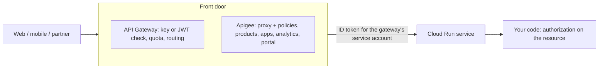

Your backend runs on Cloud Run. Web and mobile call it with access tokens, and nobody has thought about a gateway. Then sales closes the first partner deal. The partner needs a key, a rate limit, and a contract that says "10,000 calls a day." Someone in the meeting says "let's put Apigee in front of it." Someone else says "API Gateway is cheaper."

Both are Google Cloud products that sit between clients and your services, so they look interchangeable. They are not. **API Gateway** is a managed front door: it validates who is calling, applies a simple quota, and routes to a serverless backend. **Apigee** is an API management platform: it treats your API as a product with consumers, plans, analytics, a developer portal, and optionally billing.

Pick Apigee when you only needed a front door, and you pay hundreds of dollars a month before the first request, plus a proxy layer your team has to learn. Pick API Gateway when you actually run an API program, and you rebuild onboarding, usage reporting, and per-partner contracts by hand. The question is not which product is better. It is **which problem you have**.

## Two problems that look like one

A **gateway** answers runtime questions for each request:

- Is this caller allowed in? (API key, JWT)
- Is it over its limit?
- Which backend handles this path?

An **API management platform** answers business questions about the API as a whole:

- Who are our consumers, and which plan is each one on?
- How do partners discover the API, read docs, and get credentials without a ticket?
- Which partner generates which traffic, and are we billing for it?
- How do we version, deprecate, and govern dozens of APIs across teams?

Every API management platform includes a gateway. Not every API needs the platform. If the only consumers are your own clients, the second list is mostly empty.



The diagram shows what does not change with either choice. The backend still decides what this caller may do with this resource. A gateway identifies the caller and enforces coarse limits. Authorization stays in your service, as covered in [JWT vs API keys](/blog/jwt-vs-api-keys/).

## What API Gateway is

API Gateway is a fully managed gateway for backends on Google Cloud, typically Cloud Run, Cloud Run functions, and App Engine. You describe the API in an OpenAPI document (2.0 or 3.x), add Google extensions for routing, authentication, and quotas, and deploy it. There is nothing to run or scale.

It has three resources:

- **API**: the logical API. It owns a managed service name that consumers enable to use API keys.
- **API config**: one immutable version of your OpenAPI document, plus the service account the gateway uses to call your backend.
- **Gateway**: a regional deployment of one API config, with a URL on `*.gateway.dev`. A new version means a new API config and an update of the gateway to point at it.

What it can do per request:

- **Authenticate the caller** with API keys, Google ID tokens, service accounts, or any JWT issuer with a JWKS endpoint (Firebase, Auth0, your own IdP).
- **Enforce quotas** per consumer project, defined in the OpenAPI document. The only supported unit is requests per minute per project.
- **Call the backend with its own identity.** The gateway sends a Google-signed ID token for its service account, so the Cloud Run service can require IAM authentication and accept only the gateway.

What it does not do: request or response transformation, caching, response mediation, a developer portal, monetization, or analytics beyond Cloud Monitoring and Cloud Logging. It is a front door, not a platform.

## What Apigee is

Apigee is Google Cloud's API management platform. It runs **API proxies** between clients and backends (REST, gRPC, SOAP, and GraphQL), and attaches **policies** to each proxy for security, traffic management, mediation, caching, and custom logic.

On top of the proxy layer, it models the business side:

- **API products** bundle operations (proxy plus paths plus methods) and carry default quotas. An API key is provisioned for a product, not for a raw API.
- **Developers and apps.** A partner registers an app, the app is associated with one or more products, and it receives a consumer key. That key is the credential the partner sends.
- **Analytics** on traffic, latency, and errors per product, app, and developer.
- **Developer portal** for discovery, docs, and self-service registration.
- **Monetization**: rate plans on API products, with prepaid or postpaid billing.
- **Deployment options**: Apigee runs on Google Cloud. Apigee hybrid runs the runtime plane in your own Kubernetes clusters, on-premises or in other clouds.

That is a lot of capability, and each piece comes with concepts to learn: organizations, environments, environment groups, proxy bundles, shared flows, flow variables, and policy XML.

## Side by side

| | API Gateway | Apigee |
| --- | --- | --- |
| Primary job | Managed front door for serverless backends | Run an API program: products, consumers, plans |
| Configuration | OpenAPI 2.0 or 3.x with `x-google-*` extensions | Proxy bundles with XML policies, plus products and apps |
| Caller authentication | API keys, Google ID tokens, JWT from any issuer with a JWKS | API keys per app and product, OAuth 2.0, JWT, SAML, and more via policies |
| Rate limiting | Per-minute quota per consumer project | `SpikeArrest` (bursts) and `Quota` (per app, per contract, hourly to monthly) |
| Transformation | No | Yes: headers, payloads, protocol mediation, caching |
| Consumer management | Google Cloud projects that enable the API | Developers, apps, API products |
| Developer portal | No | Yes |
| Monetization | No | Yes |
| Analytics | Cloud Monitoring and Logging | Per product, app, and developer |
| Where it runs | Google-managed, regional | Google Cloud, or hybrid in your clusters |
| Pricing model | Per call, first 2M per month free | Environments per hour, plus calls, plus add-ons; or a subscription |

A third product, **Cloud Endpoints**, shares the OpenAPI extensions and authentication model with API Gateway, but you run its proxy (ESPv2) on your own runtime. Google's guidance positions it for gRPC services and for teams that want control over the proxy's runtime and network. For a new REST API on serverless, the choice is between the two above.

## When to use each one, and when to use neither

**No gateway at all** fits more cases than people expect:

- The API is internal or first-party. Your web and mobile clients authenticate users with your IdP, and your service validates the token.
- Service-to-service calls inside Google Cloud. Cloud Run with IAM authentication and `roles/run.invoker` on the caller already answers "who is calling."
- You need rate limiting per user or per route. That is application logic, and it often lives better in the service. See [CORS, rate limiting, and Helmet in NestJS](/blog/cors-rate-limiting-security-headers-nestjs/).

Adding a gateway there adds a hop, a config to deploy, and a second place to debug, without a consumer that needs it.

**API Gateway** fits when:

- you expose a serverless backend to external consumers and need keys or JWT validation before the request reaches your code.
- a per-minute limit per consumer is enough.
- you want one OpenAPI document as the contract and the gateway config.
- consumers can be onboarded by hand: you create keys for a handful of partners.

**Apigee** fits when:

- the API is a product: many partners, self-service onboarding, a portal, tiers.
- limits are contractual (calls per day or month per app), not just protective.
- you need transformation or mediation: legacy SOAP backends, response shaping, caching.
- you need per-consumer analytics, governance across many APIs and teams, or billing.
- backends live in private networks, on-premises, or across clouds, including with hybrid.

A useful test: **list the consumers and who onboards them.** If the answer is "our apps" or "three partners, set up by an engineer," you do not need API management yet. If it is "partners sign up, pick a plan, and we report on their usage," you do.

## A practical API Gateway setup

The scenario: an `orders` service on Cloud Run, exposed to partners. Partners send an API key and get a per-minute quota.

```yaml
swagger: "2.0"
info:
  title: orders-api
  version: "1.0.0"
schemes: [https]
produces: [application/json]
x-google-backend:
  address: https://orders-abc123-uc.a.run.app
  deadline: 10.0
securityDefinitions:
  api_key:
    type: apiKey
    name: x-api-key
    in: header
security:
  - api_key: []
x-google-management:
  metrics:
    - name: read-requests
      displayName: Read requests
      valueType: INT64
      metricKind: DELTA
  quota:
    limits:
      - name: read-requests-limit
        metric: read-requests
        unit: 1/min/{project}
        values:
          STANDARD: 600
paths:
  /orders/{orderId}:
    get:
      operationId: getOrder
      parameters:
        - name: orderId
          in: path
          required: true
          type: string
      x-google-quota:
        metricCosts:
          read-requests: 1
      responses:
        "200":
          description: Order
```

Decisions in that file that matter more than the syntax:

**`x-google-backend` at the top level** sends every path to the same Cloud Run service, with the request path appended to `address` by default. The gateway authenticates to Cloud Run with an ID token whose audience defaults to `address`.

**`deadline: 10.0`.** The default is 15 seconds. Set it to what the backend's real latency justifies, the same way you would for any client.

**The quota is per consumer project, per minute.** The consumer project is the one that owns the API key. Six hundred requests per minute protects the backend. It cannot express "10,000 per day," and it cannot give one partner a different plan without a per-consumer override. If those are requirements, that is the signal for Apigee.

**Partners send the key in a header.** The default location for API keys is a `key` query parameter, which ends up in access logs and browser history. A header avoids that.

Deploy it:

```bash
gcloud api-gateway apis create orders-api

gcloud api-gateway api-configs create orders-v1 \
  --api=orders-api --openapi-spec=openapi.yaml \
  --backend-auth-service-account=orders-gateway@PROJECT_ID.iam.gserviceaccount.com

gcloud api-gateway gateways create orders-gateway \
  --api=orders-api --api-config=orders-v1 \
  --location=us-central1
```

Two steps people miss. Grant the gateway's service account `roles/run.invoker` on the Cloud Run service, and remove public invocation, or partners can call `*.run.app` directly and skip the key, the quota, and the gateway. Also, an API key only works when the API's managed service (shown by `gcloud api-gateway apis describe`) is enabled in the project where the key was created.

## What your backend receives

With `x-google-backend`, API Gateway rewrites authentication headers on the way in:

- `Authorization` now carries the gateway's ID token. Cloud Run verifies it before your code runs.
- If the client sent its own `Authorization` header, the original value moves to `X-Forwarded-Authorization`.
- If the gateway validated a JWT, the payload is in `X-Apigateway-Api-Userinfo`, base64url-encoded.

```typescript
import { createParamDecorator, ExecutionContext, UnauthorizedException } from "@nestjs/common";

export const GatewayUser = createParamDecorator((_: unknown, ctx: ExecutionContext) => {
  const header = ctx.switchToHttp().getRequest().headers["x-apigateway-api-userinfo"];
  if (typeof header !== "string") throw new UnauthorizedException();
  return JSON.parse(Buffer.from(header, "base64url").toString("utf8")) as { sub: string; scope?: string };
});
```

Trust that header **only** because Cloud Run accepts nothing but the gateway's service account. If the service also allows unauthenticated invocations, anyone can send `X-Apigateway-Api-Userinfo` with any `sub` they want. The gateway tells you who the caller is. Your service still decides whether `sub` may read order `ord_123`.

## The same front door in Apigee

In Apigee, the partner flow is modeled differently. You create an API product `orders-partner` with the `orders` proxy and a quota of 10,000 calls per day. The partner registers an app for that product and receives a consumer key. The proxy then runs three policies in order:

```xml
<VerifyAPIKey name="verify-api-key">
  <APIKey ref="request.header.x-api-key"/>
</VerifyAPIKey>
```

```xml
<SpikeArrest name="spike-arrest">
  <Rate>20ps</Rate>
  <Identifier ref="verifyapikey.verify-api-key.client_id"/>
  <UseEffectiveCount>true</UseEffectiveCount>
</SpikeArrest>
```

```xml
<Quota name="partner-quota">
  <Identifier ref="verifyapikey.verify-api-key.client_id"/>
  <Interval ref="verifyapikey.verify-api-key.apiproduct.developer.quota.interval">1</Interval>
  <TimeUnit ref="verifyapikey.verify-api-key.apiproduct.developer.quota.timeunit">day</TimeUnit>
  <Allow count="1000" countRef="verifyapikey.verify-api-key.apiproduct.developer.quota.limit"/>
</Quota>
```

The difference from API Gateway is in the `ref` attributes. The limit is not hardcoded in the proxy. It comes from the **API product** the key belongs to. A second partner on a "premium" product with 100,000 calls a day uses the same proxy, with no redeploy. `SpikeArrest` protects the backend from bursts. `Quota` enforces the contract. Google's docs draw that line explicitly. A quota set on a product is not enforced on its own: it takes effect only when a `Quota` policy in the proxy references it.

That is the trade. You get per-contract limits, per-app analytics, and self-service onboarding. You also own proxy bundles, flow variables, policy ordering, and environment deployments.

## What it costs

**API Gateway** bills per call, per billing account:

| Calls per month | Price per million |
| --- | ---: |
| First 2M | $0 |
| 2M to 1B | $3.00 |
| Over 1B | $1.50 |

Data transfer is billed separately. At 10 million calls a month, the gateway costs about $24.

**Apigee** has three ways in: an **evaluation** organization for trying it, **pay-as-you-go**, and **subscription** contracts negotiated with Google. Pay-as-you-go list prices bill:

- **Environments, per hour, per region**: Base $0.50, Intermediate $2.00, Comprehensive $4.70.
- **API calls, per million**: standard proxies $20 (first 50M), extensible proxies $100. Extensible proxies require Intermediate or Comprehensive environments.
- **Add-ons**: API Analytics at $20 per million calls, Advanced API Security at $350 per million calls.
- **Networking**: IP addresses, forwarding rules, and data transfer, as Google Cloud resources.

One Base environment running all month is about $365 before any traffic. At 10 million standard calls, that becomes about $565 a month, compared with about $24 on API Gateway. These are list prices at the time of writing. Check the pricing pages for your region before you decide.

The bill is not the whole cost. Apigee also needs someone on the team who understands proxies, policies, and environments. That is worth paying for when the API is a product. It is pure overhead when the only consumers are three partners and a quota per minute.

## Common mistakes

**1. Apigee as an expensive rate limiter.** If the only policies are `VerifyAPIKey` and `SpikeArrest`, and nobody uses products, apps, analytics, or the portal, API Gateway does the same job for a fraction of the cost.

**2. A backend that can be reached around the gateway.** Cloud Run left with public invocation, or a second URL nobody remembers. Every limit and key check in the gateway is optional for anyone who finds `*.run.app`. Require IAM authentication and grant `roles/run.invoker` only to the gateway's service account.

**3. Treating the API key as authorization.** A key identifies the calling application. It does not say which orders that application may read. Authorization stays in the service. [JWT vs API keys](/blog/jwt-vs-api-keys/) covers the difference.

**4. Business logic in the gateway.** Pricing rules in a JavaScript policy, or data mapping that only the gateway knows about. It is harder to test, harder to version, and on Apigee the JavaScript policy is an extensible policy, which moves the proxy to the extensible price tier. Keep the gateway on identity, limits, routing, and simple mediation.

**5. Duplicate rate limits with no owner.** A quota in the gateway, a throttler in the service, and a Cloud Armor rule, with three different numbers. Decide which layer protects capacity (gateway or edge) and which enforces per-user fairness (service), and document both.

**6. Trusting `X-Apigateway-Api-Userinfo` on a public service.** That header is meaningful only when the gateway is the only possible caller.

**7. API keys in the query string.** That is the API Gateway default. Keys end up in logs, proxies, and browser history. Use a header.

## Before production

- The backend accepts only the gateway's identity. No public invocation, no forgotten URLs.
- One service account for the gateway, with `roles/run.invoker` on the services it fronts and nothing else.
- An explicit `deadline` (API Gateway) or target timeout (Apigee) based on backend latency.
- Gateway config in version control and deployed by CI: the OpenAPI document for API Gateway, proxy bundles and products for Apigee. No console edits.
- Keys sent in headers, with a rotation process for each consumer.
- Alerts on 429s and 5xx at the gateway, so you can tell a partner over quota from a broken backend.

## Pick the problem, then the product

API Gateway is a front door: it checks who is calling, limits how fast, and routes to a serverless backend. Apigee is a platform for running APIs as products, with consumers, contracts, and reports that someone outside engineering reads. If the API has no consumers you do not control, you may need neither.

Before the next meeting, write down who consumes the API and who onboards them. If that list fits in a spreadsheet you maintain by hand, start with API Gateway. Move to Apigee when partners need to onboard themselves.

## Sources

- [About API Gateway](https://docs.cloud.google.com/api-gateway/docs/about-api-gateway)
- [OpenAPI overview (API Gateway)](https://docs.cloud.google.com/api-gateway/docs/openapi-overview)
- [OpenAPI 2.0 extensions in API Gateway](https://docs.cloud.google.com/api-gateway/docs/oasv2-extensions)
- [Use JWTs to authenticate users (API Gateway)](https://docs.cloud.google.com/api-gateway/docs/authenticating-users-jwt)
- [Restrict API access with API keys (API Gateway)](https://docs.cloud.google.com/api-gateway/docs/authenticate-api-keys)
- [Secure traffic to a service with the gcloud CLI](https://docs.cloud.google.com/api-gateway/docs/secure-traffic-gcloud)
- [API Gateway quotas and limits](https://docs.cloud.google.com/api-gateway/docs/quotas)
- [API Gateway pricing](https://cloud.google.com/api-gateway/pricing)
- [What is Apigee?](https://docs.cloud.google.com/apigee/docs/api-platform/get-started/what-apigee)
- [What is an API product?](https://docs.cloud.google.com/apigee/docs/api-platform/publish/what-api-product)
- [VerifyAPIKey policy](https://docs.cloud.google.com/apigee/docs/api-platform/reference/policies/verify-api-key-policy)
- [SpikeArrest policy](https://docs.cloud.google.com/apigee/docs/api-platform/reference/policies/spike-arrest-policy)
- [Quota policy](https://docs.cloud.google.com/apigee/docs/api-platform/reference/policies/quota-policy)
- [Apigee monetization overview](https://docs.cloud.google.com/apigee/docs/api-platform/monetization/overview)
- [Apigee pay-as-you-go pricing](https://docs.cloud.google.com/apigee/docs/api-platform/reference/pay-as-you-go-updated-overview)
- [Using Google authentication (Apigee)](https://docs.cloud.google.com/apigee/docs/api-platform/security/google-auth/overview)
- [JavaScript policy (Apigee)](https://docs.cloud.google.com/apigee/docs/api-platform/reference/policies/javascript-policy)
- [Choosing between Apigee, API Gateway, and Cloud Endpoints](https://cloud.google.com/blog/products/application-modernization/choosing-between-apigee-api-gateway-and-cloud-endpoints)
