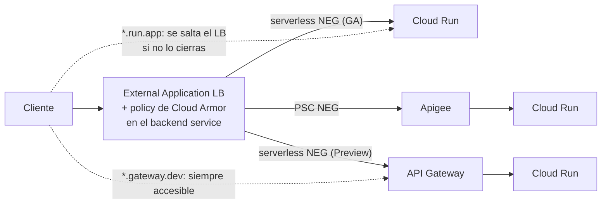

Tu API corre en Cloud Run, con `@nestjs/throttler` en la ruta de login. Una noche, un ataque de credential stuffing golpea `/auth/login` desde unas miles de IPs. El throttler hace su trabajo: rechaza cada request con 429. Pero cada una de esas requests ya había llegado a Cloud Run. Las instancias escalaron para responderlas, y los usuarios reales esperaron detrás de los atacantes. El límite funcionó. La protección no.

El rate limiting en la aplicación decide *después* de que la request llegó a tu código. Hay tráfico que nunca debería llegar tan lejos: sondeos de SQL injection, scanners, floods desde una sola dirección, requests de países a los que no das servicio. **Cloud Armor** es la respuesta de Google Cloud para esa capa. Filtra las requests en el edge de Google, antes de que lleguen a tu backend.

También se malinterpreta en la otra dirección. Tener un WAF delante de la API no significa que la API sea segura. Cloud Armor no sabe quiénes son tus usuarios ni qué pedidos pueden leer, y no puede frenar una request que nunca pasa por él. Este artículo cubre dónde se ubica, qué hace bien y qué sigue siendo responsabilidad de tu gateway y de tu código.

## Dónde vive realmente Cloud Armor

Un modelo mental común es una cadena de cajas: `Load balancer → Cloud Armor → gateway → backend`. Se acerca, pero esconde el detalle más importante.

**Cloud Armor no es un salto de red.** Es una *security policy*, un conjunto de reglas, que se adjunta a un **backend service de un load balancer**. Google la evalúa en el borde de su red, antes de que el tráfico llegue a tu VPC o a tu backend serverless. Sin un load balancer soportado no hay dónde adjuntarla. Además, una policy no tiene efecto hasta que la adjuntas a un backend service.

Los load balancers soportados incluyen todos los External Application Load Balancers (global, regional y classic), el regional internal Application Load Balancer y los proxy Network Load Balancers global y classic. Para una API HTTP, en la práctica significa un External Application Load Balancer.

En Google Cloud, las tres arquitecturas que más probablemente construyas son estas:



**LB → Cloud Run.** El setup más directo. Un serverless NEG apunta al servicio de Cloud Run y la policy lo protege. No hace falta gateway. Para una API first-party, donde tus propios clientes autentican a los usuarios con tu IdP, muchas veces esa es toda la arquitectura.

**LB → Apigee → Cloud Run.** Es el patrón que documenta Google para Apigee. El External Application Load Balancer llega a Apigee con un NEG de Private Service Connect, y Cloud Armor va en ese backend service. Una restricción: el Application Load Balancer classic no soporta backends PSC NEG para Apigee, así que usa el global external Application Load Balancer actual.

**LB → API Gateway → Cloud Run.** Este es más débil. Poner un load balancer delante de API Gateway requiere un serverless NEG que apunte al gateway, y esa opción está en **Preview**. Además, API Gateway no tiene control de ingress. La documentación de Google dice que no hay forma de deshabilitar la URL generada `*.gateway.dev` para forzar todo el tráfico por el load balancer. Quien conozca ese hostname se salta Cloud Armor. Si necesitas protección en el edge y un gateway, eso solo ya es motivo para mirar Apigee. Si solo necesitas protección en el edge, ve directo a Cloud Run. [Apigee vs API Gateway](/blog/apigee-vs-api-gateway/) cubre esa decisión.

Las líneas punteadas son la lección real. **Una policy protege el camino que pasa por el load balancer, y solo ese camino.**

## Cierra el camino alternativo

Cada servicio de Cloud Run recibe una URL por defecto `*.run.app`. Si sigue accesible desde internet, un atacante que la encuentre se salta el load balancer y todas las reglas de Cloud Armor. La documentación de Cloud Armor lo indica directamente como limitación para backends serverless.

En el setup LB → Cloud Run, ciérralo en el servicio:

```bash
gcloud run services update orders \
  --region=us-central1 \
  --ingress=internal-and-cloud-load-balancing \
  --no-default-url
```

`internal-and-cloud-load-balancing` acepta tráfico de External Application Load Balancers y de fuentes internas, y rechaza las requests directas desde internet a `run.app`. `--no-default-url` elimina la URL por completo. Antes de deshabilitarla, revisa qué depende de ella. Cloud Scheduler, Cloud Tasks y Pub/Sub push usan la URL por defecto y dejan de funcionar sin ella.

Detrás de Apigee o de API Gateway, la protección del backend es la identidad, no el ingress. Exige autenticación IAM en Cloud Run y da `roles/run.invoker` solo a la service account del gateway. Prueba cualquier restricción de ingress con tu topología exacta antes de depender de ella.

## Qué protege Cloud Armor

**DDoS volumétrico.** Cloud Armor da protección DDoS automática a los load balancers que soporta, en cualquier tier. No hay nada que configurar. Enterprise suma protección L3/L4 always-on y visibilidad de los ataques.

**Patrones de ataque conocidos (WAF).** Las reglas preconfiguradas, basadas en el OWASP Core Rule Set, detectan SQL injection, XSS, inclusión de archivos locales y remotos, ejecución remota de código, scanners, ataques de protocolo y más. Se activan con una expresión:

```text
evaluatePreconfiguredWaf('sqli-v422-stable', {'sensitivity': 1})
```

Cada firma tiene un **nivel de sensibilidad**, que corresponde a un paranoia level del CRS. El nivel 1 contiene firmas de alta confianza con pocos falsos positivos. Los niveles más altos detectan más y bloquean más tráfico legítimo. Si no indicas ninguno, el default es el nivel 4, que evalúa todas las firmas. Google recomienda los rule sets de CRS 4.22 (`-v422-`) para policies nuevas. Por defecto, las reglas preconfiguradas inspeccionan solo los primeros 64 KB del body.

**Reglas custom.** Puedes filtrar por rangos de IP, país (`origin.region_code`), ASN, headers, path, método o query, y luego permitir, denegar, redirigir o aplicar rate limit. Es el lugar para allowlists delante de una ruta de admin, restricciones geográficas que la ley te obliga a aplicar y blocklists durante un incidente.

**Rate limiting en el edge.** Dos acciones:

- `throttle` limita las requests por clave e intervalo. Las que superan el límite reciben la exceed action (`deny-429`, por ejemplo) durante el resto del intervalo.
- `rate-based-ban` también limita la tasa, y cuando un cliente cruza el umbral, Cloud Armor bloquea todas sus requests durante un periodo fijo (de 60 a 3.600 segundos).

La clave puede ser la IP del cliente, el valor de un header, una cookie, el path, la región, un fingerprint TLS (JA3/JA4), el ASN y más. Se pueden combinar hasta tres claves.

**Bots.** El bot management se integra con reCAPTCHA. Puede redirigir el tráfico sospechoso a un desafío o evaluar un token de reCAPTCHA adjunto a la request. Los desafíos necesitan un navegador. Para APIs, lo relevante son los action-tokens, que funcionan en sitios web y en apps de iOS y Android. Los clientes servidor a servidor no pueden resolver un desafío, así que no pongas reglas de desafío en rutas de partners.

**Adaptive Protection y threat intelligence.** Adaptive Protection aprende los patrones de tu tráfico, alerta sobre ataques DDoS en L7 y sugiere reglas para frenarlos. Standard solo recibe las alertas. La Adaptive Protection completa, los feeds de Google Threat Intelligence y las named IP lists de terceros requieren **Cloud Armor Enterprise**.

## Qué no protege

| Amenaza | Cloud Armor | Gateway (Apigee / API Gateway) | Tu servicio |
| --- | --- | --- | --- |
| DDoS volumétrico, floods por IP | Sí | En parte (cuotas) | No: ya es tarde |
| SQLi, XSS, scanners | Sí (WAF) | En parte (policies en Apigee) | Sí: queries parametrizadas, validación |
| Cliente desconocido | No | Sí: API key, JWT | Sí: validación del token |
| El usuario A lee el pedido del usuario B (BOLA/IDOR) | No | No | **Sí, solo aquí** |
| Cuotas contractuales (10.000/día por partner) | No: es aproximado | Sí (`Quota` de Apigee) | Posible |
| Abuso dentro de los límites | No | En parte | Sí: reglas de negocio |
| Tráfico que se salta el LB (`run.app`, `gateway.dev`) | **No** | No para `gateway.dev` | IAM, ingress |

Tres filas merecen énfasis.

**La autorización vive en tu código.** Un WAF lee requests, no tu modelo de datos. `GET /orders/ord_123` con un token válido de otro usuario es una request perfectamente bien formada. Solo el servicio dueño del pedido puede rechazarla. [JWT vs API keys](/blog/jwt-vs-api-keys/) explica qué te puede decir cada credencial y qué no.

**Los rate limits del edge son aproximados.** La documentación de Google lo dice sin rodeos: los umbrales se aplican de forma independiente en cada región donde corren los backends, y los conteos pueden no ser exactos. Google recomienda el rate limiting en el edge para mitigar abuso y mantener la disponibilidad, **no** para cuotas estrictas ni licenciamiento. Las "10.000 llamadas al día" del contrato de un partner van en la policy `Quota` de Apigee o en tu propia medición.

**Cloud Armor no es autenticación.** Una allowlist de IPs en `/admin` reduce la exposición, pero no reemplaza al login. Las IPs se comparten, rotan y, a veces, se falsifican antes de llegar a ti.

## Tres capas de rate limiting, tres claves distintas

La confusión sobre "dónde va el rate limiting" desaparece cuando te preguntas **qué puede identificar cada capa**:

- **Cloud Armor** ve la IP, los headers, el path, el país y el fingerprint TLS. No puede verificar identidad. Úsalo para proteger la **capacidad**: floods, fuerza bruta por IP, scrapers.
- **El gateway** conoce la aplicación gracias a una API key o un JWT verificados. Úsalo para **límites por consumidor y contratos**.
- **Tu servicio** conoce al usuario y al recurso. Úsalo para **equidad y reglas de negocio**: cinco resets de contraseña por cuenta y hora, un checkout a la vez. [CORS, rate limiting y Helmet en NestJS](/blog/cors-rate-limiting-security-headers-nestjs/) cubre esa capa.

Deja por escrito qué capa es dueña de cada número. Tres límites con tres valores sin relación y sin dueño es la falla más común, y la más difícil de depurar en medio de un incidente.

Hay una clave que requiere cuidado extra: **la IP**. El CGNAT de las operadoras, las redes corporativas y el Wi-Fi de un campus ponen a miles de usuarios reales detrás de una sola dirección. Un ban por IP estricto en un endpoint público puede dejar fuera a una oficina entera. Sé generoso con los límites por IP en rutas públicas y estricto en las de credenciales, y considera combinar la IP con un header o un fingerprint TLS.

## Una policy práctica para una API en Cloud Run

El escenario: un global external Application Load Balancer con el backend service `orders-backend`, que apunta a un serverless NEG del servicio `orders` de Cloud Run. El objetivo es una base WAF, protección contra fuerza bruta en el login y nada que bloquee a usuarios reales el primer día.

```bash
gcloud compute security-policies create orders-edge \
  --description="Edge policy for the orders API"

# Base WAF: SQLi y XSS con sensibilidad 1, observadas antes de aplicarlas.
gcloud compute security-policies rules create 1000 \
  --security-policy=orders-edge \
  --expression="evaluatePreconfiguredWaf('sqli-v422-stable', {'sensitivity': 1})" \
  --action=deny-403 \
  --preview

gcloud compute security-policies rules create 1010 \
  --security-policy=orders-edge \
  --expression="evaluatePreconfiguredWaf('xss-v422-stable', {'sensitivity': 1})" \
  --action=deny-403 \
  --preview

# Fuerza bruta en login: 20 requests por minuto por IP, luego un ban de 10 minutos.
gcloud compute security-policies rules create 500 \
  --security-policy=orders-edge \
  --expression="request.path.matches('^/auth/login$')" \
  --action=rate-based-ban \
  --rate-limit-threshold-count=20 \
  --rate-limit-threshold-interval-sec=60 \
  --ban-duration-sec=600 \
  --conform-action=allow \
  --exceed-action=deny-429 \
  --enforce-on-key=IP

gcloud compute backend-services update orders-backend \
  --global \
  --security-policy=orders-edge
```

Las decisiones de ese setup importan más que los flags:

**Las reglas WAF empiezan en preview.** `--preview` registra lo que la regla *habría* hecho sin aplicarlo. Esas requests se cobran igual. Después de una semana de tráfico real sabes qué firmas saltan con requests legítimas.

**La prioridad de una regla es su orden de evaluación.** Los números más bajos se evalúan primero, así que el ban de login (500) corre antes que las reglas WAF. La regla por defecto, con prioridad 2147483647, siempre existe. Déjala en `allow` para una API pública. Un `deny` por defecto convierte la policy en una allowlist.

**El ban usa `deny-429`, no `deny-403`.** Un 429 le indica a un cliente bien hecho que debe esperar. Los códigos válidos para reglas de rate limit son 403, 404, 429 y 502.

**La regla de login es por IP.** Sirve contra credential stuffing desde direcciones que rotan a baja tasa por dirección, pero no lo resuelve del todo. Combínala con límites por cuenta en el servicio y, para clientes web y móviles, con un token de reCAPTCHA en el login.

## Ajustar sin bloquear a usuarios reales

El logging de requests en el backend service viene desactivado por defecto. Actívalo, o estarás ajustando a ciegas:

```bash
gcloud compute backend-services update orders-backend \
  --global \
  --enable-logging \
  --logging-sample-rate=1.0
```

A partir de ahí, cada entrada de log del load balancer incluye `jsonPayload.enforcedSecurityPolicy` (la regla aplicada, su `outcome` y su `configuredAction`) y, si una regla en preview coincidió primero, `jsonPayload.previewSecurityPolicy`. En las reglas WAF, `preconfiguredExprIds` indica la firma exacta que saltó. Para ver qué se está bloqueando:

```text
jsonPayload.enforcedSecurityPolicy.outcome="DENY"
```

Cuando una firma salta con tráfico legítimo, tienes tres herramientas, de la más acotada a la más amplia:

- **Excluir un campo de la inspección**, por ejemplo un header que lleva tokens opacos, con `--request-header-to-exclude` y sus equivalentes para cookies, query params y URIs.
- **Desactivar una sola firma** con `opt_out_rule_ids` en la expresión.
- **Bajar la sensibilidad** de todo el rule set.

Quita `--preview` regla por regla, cuando los logs muestren que solo bloquea lo que querías bloquear.

## Cuánto cuesta

**Cloud Armor Standard** es pay as you go: **$5 por policy al mes**, **$1 por regla al mes** y **$0.75 por millón de requests** evaluadas por una policy global (las policies regionales tienen otra tarifa por request). La policy de arriba, con cuatro reglas más la regla por defecto, cuesta unos $10 al mes más las requests. Con 100 millones de requests al mes son unos $85.

**Cloud Armor Enterprise** es una suscripción que incluye el uso del WAF y suma Adaptive Protection completa, threat intelligence, named IP lists y protección DDoS de red avanzada:

- **Paygo**: $200 al mes por proyecto, más $200 al mes por recurso protegido a partir del tercero.
- **Annual**: $3.000 al mes por cuenta de facturación, más $30 al mes por recurso protegido a partir del 101. Incluye además soporte de respuesta ante DDoS y protección de la factura ante DDoS para clientes elegibles.

Son precios de lista al momento de escribir este artículo. Para la mayoría de las APIs, Standard cubre el WAF, las reglas custom y el rate limiting. Enterprise se justifica cuando eres un objetivo probable de DDoS, o cuando alguien necesita que los feeds de threat intel y Adaptive Protection actúen y no solo alerten.

No olvides el load balancer. Si todavía no tienes uno, el costo real de Cloud Armor incluye sus forwarding rules y el procesamiento de datos.

## Cuándo no usarlo

- **APIs internas** sin load balancer externo. El tráfico entre servicios dentro de Google Cloud se protege mejor con IAM y con la configuración de ingress.
- **APIs de bajo riesgo sin load balancer**, donde el load balancer existiría solo para colgarle Cloud Armor. Para una herramienta interna pequeña, el costo y las piezas extra pueden no compensar. Para cualquier cosa pública con un formulario de login, normalmente sí compensan.
- **Como sustituto de un gateway o de la autorización.** Los complementa. No reemplaza a ninguno.

## Errores comunes

**1. Policy en el load balancer y backend accesible por fuera.** Cloud Run con `--ingress=all` y su URL `run.app`, o el hostname `gateway.dev` de API Gateway. La policy funciona, pero nadie está obligado a pasar por ella.

**2. Reglas WAF aplicadas desde el primer día.** Sensibilidad 4 sin preview bloquea requests reales: bodies JSON que parecen SQL, campos de texto enriquecido que parecen XSS. Empieza con sensibilidad 1, en preview y con logging activado.

**3. Bans por IP estrictos en rutas públicas.** Un rango NAT de una operadora móvil, un ban, y miles de usuarios fuera. Mantén los límites por IP generosos en rutas públicas y estrictos en las de credenciales.

**4. Rate limits del edge como cuotas contractuales.** Son aproximados y se aplican por región. Facturar a un partner con ellos genera disputas que no vas a poder resolver.

**5. Tratar "detrás de Cloud Armor" como "seguro".** El WAF no ve BOLA/IDOR, autenticación rota ni abuso de la lógica de negocio. El servicio sigue validando tokens y comprobando la propiedad de cada recurso.

**6. El load balancer classic delante de Apigee con PSC.** No soporta backends PSC NEG. Construye sobre el global external Application Load Balancer actual.

**7. Un `deny` por defecto sin querer.** Una policy cuya regla por defecto deniega todo, con unas pocas reglas allow, es una allowlist. Eso está bien para un backend de administración y es una caída para una API pública.

## Antes de producción

- Todo camino hacia el backend pasa por el load balancer: `run.app` cerrado con ingress o `--no-default-url`, o solo IAM si hay un gateway delante. Ninguna URL `gateway.dev` de API Gateway como puerta lateral abierta sin haber aceptado ese riesgo.
- Logging de requests activado en el backend service.
- Reglas WAF de CRS 4.22, sensibilidad 1, observadas en preview antes de aplicarlas.
- Rate limits documentados por capa: edge para capacidad, gateway para consumidores, servicio para usuarios.
- Una alerta ante picos de outcomes `DENY`, para que un falso positivo lo encuentres tú y no tus usuarios.
- Policies definidas en Terraform o desplegadas por CI, sin reglas que solo existan en la consola.

## Primero el edge, pero no solo el edge

Cloud Armor elimina el tráfico que nunca debería llegar a tu código: floods, patrones de ataque conocidos, fuerza bruta, regiones a las que no das servicio. Lo hace en el edge de Google, donde descartarlo es más barato. No conoce a tus usuarios, ni tus contratos, ni tus datos. El gateway sigue identificando a los consumidores, y tu servicio sigue decidiendo quién puede tocar qué recurso.

Antes de escribir la primera regla, haz la lista de todas las URLs que llegan a tu backend. Si alguna no pasa por el load balancer, arregla eso primero. Si no, la policy protege un camino que nadie está obligado a usar.

## Fuentes

- [Cloud Armor overview](https://docs.cloud.google.com/armor/docs/cloud-armor-overview)
- [Security policy overview](https://docs.cloud.google.com/armor/docs/security-policy-overview)
- [Integrating Cloud Armor with other Google products](https://docs.cloud.google.com/armor/docs/integrating-cloud-armor)
- [Manage Cloud Armor security policies](https://docs.cloud.google.com/armor/docs/manage-security-policies)
- [Manage Cloud Armor security policy rules](https://docs.cloud.google.com/armor/docs/manage-security-policy-rules)
- [Preconfigured WAF rules](https://docs.cloud.google.com/armor/docs/waf-rules)
- [Tune preconfigured WAF rules](https://docs.cloud.google.com/armor/docs/rule-tuning)
- [Rate limiting overview](https://docs.cloud.google.com/armor/docs/rate-limiting-overview)
- [Configure rate limiting](https://docs.cloud.google.com/armor/docs/configure-rate-limiting)
- [Bot management overview](https://docs.cloud.google.com/armor/docs/bot-management)
- [Request logging](https://docs.cloud.google.com/armor/docs/request-logging)
- [Cloud Armor Enterprise overview](https://docs.cloud.google.com/armor/docs/armor-enterprise-overview)
- [Cloud Armor pricing](https://cloud.google.com/armor/pricing)
- [Serverless NEG concepts](https://docs.cloud.google.com/load-balancing/docs/negs/serverless-neg-concepts)
- [Restrict network ingress for Cloud Run](https://docs.cloud.google.com/run/docs/securing/ingress)
- [Load balancing for API Gateway](https://docs.cloud.google.com/api-gateway/docs/gateway-load-balancing)
- [Northbound networking with Private Service Connect (Apigee)](https://docs.cloud.google.com/apigee/docs/api-platform/system-administration/psc-overview)
