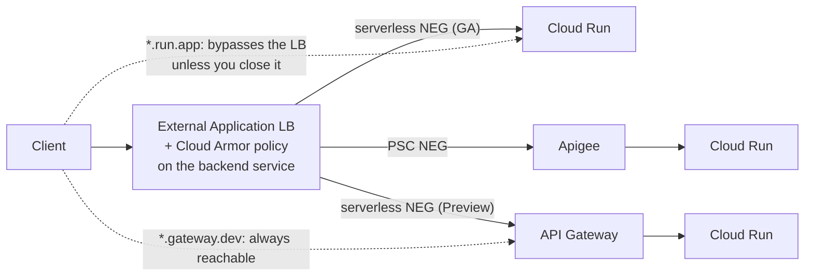

Your API runs on Cloud Run, with `@nestjs/throttler` on the login route. One night, a credential-stuffing run hits `/auth/login` from a few thousand IP addresses. The throttler does its job: it rejects each request with 429. But every one of those requests already reached Cloud Run. Instances scaled out to answer them, and real users waited behind the attackers. The limit worked. The protection did not.

Application rate limiting decides *after* the request has reached your code. Some traffic should never get that far: SQL injection probes, scanners, floods from one address, requests from countries you do not serve. **Cloud Armor** is Google Cloud's answer for that layer. It filters requests at Google's edge, before they reach your backend.

It also gets misunderstood the other way. A WAF in front of the API does not mean the API is secure. Cloud Armor does not know who your users are or which orders they may read, and it cannot stop a request that never passes through it. This article covers where it sits, what it does well, and what stays with your gateway and your code.

## Where Cloud Armor actually sits

A common mental model is a chain of boxes: `Load balancer → Cloud Armor → gateway → backend`. That is close, but it hides the detail that matters most.

**Cloud Armor is not a hop.** It is a *security policy*, a set of rules, that you attach to a **backend service of a load balancer**. Google evaluates it at the edge of its network, before traffic reaches your VPC or your serverless backend. Without a supported load balancer, there is nothing to attach it to. A policy also has no effect until it is attached to a backend service.

Supported load balancers include all external Application Load Balancers (global, regional, and classic), the regional internal Application Load Balancer, and the global and classic proxy Network Load Balancers. For an HTTP API, that means an external Application Load Balancer in practice.

On Google Cloud, the three architectures you are most likely to build look like this:



**LB → Cloud Run.** The most direct setup. A serverless NEG points to the Cloud Run service, and the policy protects it. No gateway is needed. For a first-party API, where your own clients authenticate users with your IdP, this is often the whole architecture.

**LB → Apigee → Cloud Run.** This is the pattern Google documents for Apigee. The external Application Load Balancer reaches Apigee through a Private Service Connect NEG, and Cloud Armor goes on that backend service. One constraint: the classic Application Load Balancer does not support PSC NEG backends for Apigee, so use the current global external Application Load Balancer.

**LB → API Gateway → Cloud Run.** This one is weaker. Putting a load balancer in front of API Gateway requires a serverless NEG that points to the gateway, and that capability is in **Preview**. API Gateway also has no ingress control. Google's docs say there is no way to disable the generated `*.gateway.dev` URL to force all traffic through the load balancer. Anyone who knows that hostname skips Cloud Armor. If you need edge protection and a gateway, that alone is a reason to look at Apigee. If you only need edge protection, go straight to Cloud Run. [Apigee vs API Gateway](/blog/apigee-vs-api-gateway/) covers that decision.

The dashed lines are the real lesson. **A policy protects the path through the load balancer, and only that path.**

## Close the path around it

Every Cloud Run service gets a default `*.run.app` URL. If it stays reachable from the internet, an attacker who finds it bypasses the load balancer and every Cloud Armor rule. Google's Cloud Armor docs state this limitation for serverless backends directly.

For the LB → Cloud Run setup, close it at the service:

```bash
gcloud run services update orders \
  --region=us-central1 \
  --ingress=internal-and-cloud-load-balancing \
  --no-default-url
```

`internal-and-cloud-load-balancing` accepts traffic from external Application Load Balancers and internal sources, and rejects direct internet requests to `run.app`. `--no-default-url` removes the URL entirely. Before you disable it, check what depends on it. Cloud Scheduler, Cloud Tasks, and Pub/Sub push to the default URL, and they stop working without it.

Behind Apigee or API Gateway, the backend's guard is identity, not ingress. Require IAM authentication on Cloud Run and grant `roles/run.invoker` only to the gateway's service account. Test any ingress restriction with your exact topology before relying on it.

## What Cloud Armor protects

**Volumetric DDoS.** Cloud Armor automatically provides DDoS protection for the load balancers it supports, in any tier. You do not configure it. Enterprise adds always-on L3/L4 protection and attack visibility on top.

**Known attack patterns (WAF).** Preconfigured rules based on the OWASP Core Rule Set detect SQL injection, XSS, local and remote file inclusion, remote code execution, scanners, protocol attacks, and more. You enable them with an expression:

```text
evaluatePreconfiguredWaf('sqli-v422-stable', {'sensitivity': 1})
```

Each signature has a **sensitivity level**, which maps to a CRS paranoia level. Level 1 contains high-confidence signatures with few false positives. Higher levels catch more and block more legitimate traffic. The default, if you do not set one, is level 4, which evaluates every signature. Google recommends CRS 4.22 rule sets (`-v422-`) for new policies. By default, preconfigured rules inspect only the first 64 KB of the request body.

**Custom rules.** Match on IP ranges, country (`origin.region_code`), ASN, headers, path, method, or query, and then allow, deny, redirect, or rate limit. That makes it the place for allowlists in front of an admin path, geo restrictions you are legally required to enforce, and blocklists during an incident.

**Rate limiting at the edge.** Two actions:

- `throttle` caps requests per key per interval. Requests over the limit get the exceed action (`deny-429`, for example) for the rest of the interval.
- `rate-based-ban` caps the rate too, and when a client crosses the threshold, Cloud Armor blocks all its requests for a set period (60 to 3,600 seconds).

The key can be the client IP, a header value, a cookie, the path, the region, a TLS fingerprint (JA3/JA4), the ASN, and more. Up to three keys can be combined.

**Bots.** Bot management integrates reCAPTCHA. It can redirect suspicious traffic to a challenge, or evaluate a reCAPTCHA token attached to the request. Challenges need a browser. For APIs, the relevant path is action-tokens, which work on websites and on iOS and Android apps. Server-to-server clients cannot solve a challenge, so do not put challenge rules on partner routes.

**Adaptive Protection and threat intelligence.** Adaptive Protection learns your traffic patterns and alerts on L7 DDoS attacks, suggesting rules to stop them. Standard gets alerts only. Full Adaptive Protection, Google Threat Intelligence feeds, and third-party named IP lists require **Cloud Armor Enterprise**.

## What it does not protect

| Threat | Cloud Armor | Gateway (Apigee / API Gateway) | Your service |
| --- | --- | --- | --- |
| Volumetric DDoS, floods per IP | Yes | Partly (quotas) | No: too late |
| SQLi, XSS, scanners | Yes (WAF) | Partly (policies on Apigee) | Yes: parameterized queries, validation |
| Unknown caller | No | Yes: API key, JWT | Yes: token validation |
| User A reads user B's order (BOLA/IDOR) | No | No | **Yes, only here** |
| Contract quotas (10,000/day per partner) | No: approximate | Yes (Apigee `Quota`) | Possible |
| Abuse within the limits | No | Partly | Yes: business rules |
| Traffic that skips the LB (`run.app`, `gateway.dev`) | **No** | No for `gateway.dev` | IAM, ingress |

Three rows deserve emphasis.

**Authorization lives in your code.** A WAF reads requests, not your data model. `GET /orders/ord_123` with a valid token for another user is a perfectly well-formed request. Only the service that owns the order can reject it. [JWT vs API keys](/blog/jwt-vs-api-keys/) covers what each credential can and cannot tell you.

**Edge rate limits are approximate.** Google's docs state it plainly: thresholds are enforced independently in each region where backends run, and the counts might not be strictly accurate. Google recommends edge rate limiting for abuse mitigation and availability, **not** for strict quotas or licensing. A partner's contractual "10,000 calls per day" belongs in Apigee's `Quota` policy or your own metering.

**Cloud Armor is not authentication.** An IP allowlist on `/admin` reduces exposure. It does not replace login. IP addresses are shared, rotated, and sometimes spoofed upstream of you.

## Three layers of rate limiting, three different keys

The confusion about "where should rate limiting go" disappears once you ask **what each layer can identify**:

- **Cloud Armor** sees the IP, headers, path, country, and TLS fingerprint. It cannot verify identity. Use it to protect **capacity**: floods, brute force per IP, scrapers.
- **The gateway** knows the application through a verified API key or JWT. Use it for **per-consumer limits and contracts**.
- **Your service** knows the user and the resource. Use it for **fairness and business rules**: five password resets per account per hour, one checkout at a time. [CORS, rate limiting, and Helmet in NestJS](/blog/cors-rate-limiting-security-headers-nestjs/) covers that layer.

Write down which layer owns which number. Three limits with three unrelated values and no owner is the most common failure, and it is the hardest to debug during an incident.

One key needs extra care: **IP**. Carrier-grade NAT, corporate networks, and campus Wi-Fi put thousands of real users behind one address. A tight per-IP ban on a public endpoint can lock out an entire office. Use per-IP limits generously on public routes and tightly on credential routes, and consider combining the IP with a header or a TLS fingerprint.

## A practical policy for an API on Cloud Run

The scenario: a global external Application Load Balancer with backend service `orders-backend`, pointing to a serverless NEG for the Cloud Run `orders` service. The goal is a WAF baseline, brute-force protection on login, and nothing that blocks real users on day one.

```bash
gcloud compute security-policies create orders-edge \
  --description="Edge policy for the orders API"

# WAF baseline: SQLi and XSS at sensitivity 1, observed before enforced.
gcloud compute security-policies rules create 1000 \
  --security-policy=orders-edge \
  --expression="evaluatePreconfiguredWaf('sqli-v422-stable', {'sensitivity': 1})" \
  --action=deny-403 \
  --preview

gcloud compute security-policies rules create 1010 \
  --security-policy=orders-edge \
  --expression="evaluatePreconfiguredWaf('xss-v422-stable', {'sensitivity': 1})" \
  --action=deny-403 \
  --preview

# Brute force on login: 20 requests per minute per IP, then a 10-minute ban.
gcloud compute security-policies rules create 500 \
  --security-policy=orders-edge \
  --expression="request.path.matches('^/auth/login$')" \
  --action=rate-based-ban \
  --rate-limit-threshold-count=20 \
  --rate-limit-threshold-interval-sec=60 \
  --ban-duration-sec=600 \
  --conform-action=allow \
  --exceed-action=deny-429 \
  --enforce-on-key=IP

gcloud compute backend-services update orders-backend \
  --global \
  --security-policy=orders-edge
```

Decisions in that setup that matter more than the flags:

**The WAF rules start in preview.** `--preview` records what the rule *would* have done without enforcing it. You still pay for those requests. After a week of real traffic, you know which signatures fire on legitimate requests.

**Rule priority is evaluation order.** Lower numbers are evaluated first. The login ban at 500 runs before the WAF rules. The default rule, at priority 2147483647, always exists. Leave it on `allow` for a public API. A default `deny` turns the policy into an allowlist.

**The ban uses `deny-429`, not `deny-403`.** A 429 tells a well-behaved client to back off. Valid deny codes for rate-limit rules are 403, 404, 429, and 502.

**The login rule is per IP.** That fits credential stuffing from rotating addresses at a low rate per address, but it does not solve it completely. Pair it with per-account limits in the service and, for browser and mobile clients, a reCAPTCHA token on login.

## Tuning without blocking real users

Request logging on the backend service is off by default. Turn it on, or you will be tuning blind:

```bash
gcloud compute backend-services update orders-backend \
  --global \
  --enable-logging \
  --logging-sample-rate=1.0
```

Each load balancer log entry then includes `jsonPayload.enforcedSecurityPolicy` (the rule applied, its `outcome`, and its `configuredAction`) and, when a preview rule matched first, `jsonPayload.previewSecurityPolicy`. For WAF rules, `preconfiguredExprIds` names the exact signature that fired. To see what is being blocked:

```text
jsonPayload.enforcedSecurityPolicy.outcome="DENY"
```

When a signature fires on legitimate traffic, you have three tools, from narrow to broad:

- **Exclude a field from inspection**, such as a header that carries opaque tokens, with `--request-header-to-exclude` and its siblings for cookies, query parameters, and URIs.
- **Opt out of one signature** with `opt_out_rule_ids` in the expression.
- **Lower the sensitivity** of the whole rule set.

Remove `--preview` rule by rule, after the logs show only what you meant to block.

## What it costs

**Cloud Armor Standard** is pay as you go: **$5 per policy per month**, **$1 per rule per month**, and **$0.75 per million requests** evaluated by a global policy (regional policies are billed at a different per-request rate). The policy above, with four rules plus the default rule, costs about $10 a month plus requests. At 100 million requests a month, that is about $85.

**Cloud Armor Enterprise** is a subscription that bundles WAF usage and adds full Adaptive Protection, threat intelligence, named IP lists, and advanced network DDoS protection:

- **Paygo**: $200 per month per project, plus $200 per month per protected resource after the first two.
- **Annual**: $3,000 per month per billing account, plus $30 per month per protected resource after the first 100. It also includes DDoS response support and DDoS bill protection for eligible customers.

These are list prices at the time of writing. For most APIs, Standard covers WAF, custom rules, and rate limiting. Enterprise earns its price when you are a likely DDoS target, or when someone needs threat-intel feeds and Adaptive Protection to act rather than only alert.

Remember the load balancer itself. If you do not already have one, Cloud Armor's real cost includes the load balancer's forwarding rules and data processing.

## When not to use it

- **Internal APIs** with no external load balancer. Service-to-service traffic inside Google Cloud is better protected with IAM and ingress settings.
- **Low-risk APIs with no load balancer**, where the load balancer exists only to attach Cloud Armor. For a small internal tool, the cost and the extra moving parts may not pay off. For anything public with a login form, it usually does.
- **As a substitute for a gateway or for authorization.** It complements them. It replaces neither.

## Common mistakes

**1. Policy on the load balancer, backend reachable around it.** Cloud Run left on `--ingress=all` with its `run.app` URL, or API Gateway's `gateway.dev` hostname. The policy works, and nobody has to pass through it.

**2. WAF rules enforced on day one.** Sensitivity 4 with no preview blocks real requests: JSON bodies that look like SQL, rich-text fields that look like XSS. Start at sensitivity 1, in preview, with logging on.

**3. Strict per-IP bans on public routes.** One mobile carrier's NAT range, one ban, thousands of users locked out. Keep per-IP limits generous on public routes and strict on credential routes.

**4. Edge rate limits as contract quotas.** The limits are approximate and enforced per region. Billing partners on them produces disputes you cannot settle.

**5. Treating "behind Cloud Armor" as "secure."** The WAF does not see BOLA/IDOR, broken authentication, or business-logic abuse. The service still validates tokens and checks ownership on every resource.

**6. The classic load balancer in front of Apigee with PSC.** It does not support PSC NEG backends. Build on the current global external Application Load Balancer.

**7. A default `deny` rule by accident.** A policy whose default rule denies everything, with a few allow rules, is an allowlist. That is right for an admin backend and an outage for a public API.

## Before production

- Every path to the backend goes through the load balancer: `run.app` closed with ingress or `--no-default-url`, or IAM-only behind a gateway. No API Gateway `gateway.dev` URL left as an open side door without accepting that risk.
- Request logging enabled on the backend service.
- WAF rules on CRS 4.22, sensitivity 1, observed in preview before enforcement.
- Rate limits documented per layer: edge for capacity, gateway for consumers, service for users.
- An alert on spikes in `DENY` outcomes, so a false positive is found by you, not by your users.
- Policies defined in Terraform or deployed by CI, with no console-only rules.

## Edge first, not edge only

Cloud Armor removes traffic that should never reach your code: floods, known attack patterns, brute force, regions you do not serve. It does that at Google's edge, where it is cheapest to drop. It does not know your users, your contracts, or your data. The gateway still identifies consumers, and your service still decides who may touch which resource.

Before you write the first rule, list every URL that reaches your backend. If any of them does not go through the load balancer, fix that first. Otherwise the policy is protecting a path nobody has to use.

## Sources

- [Cloud Armor overview](https://docs.cloud.google.com/armor/docs/cloud-armor-overview)
- [Security policy overview](https://docs.cloud.google.com/armor/docs/security-policy-overview)
- [Integrating Cloud Armor with other Google products](https://docs.cloud.google.com/armor/docs/integrating-cloud-armor)
- [Manage Cloud Armor security policies](https://docs.cloud.google.com/armor/docs/manage-security-policies)
- [Manage Cloud Armor security policy rules](https://docs.cloud.google.com/armor/docs/manage-security-policy-rules)
- [Preconfigured WAF rules](https://docs.cloud.google.com/armor/docs/waf-rules)
- [Tune preconfigured WAF rules](https://docs.cloud.google.com/armor/docs/rule-tuning)
- [Rate limiting overview](https://docs.cloud.google.com/armor/docs/rate-limiting-overview)
- [Configure rate limiting](https://docs.cloud.google.com/armor/docs/configure-rate-limiting)
- [Bot management overview](https://docs.cloud.google.com/armor/docs/bot-management)
- [Request logging](https://docs.cloud.google.com/armor/docs/request-logging)
- [Cloud Armor Enterprise overview](https://docs.cloud.google.com/armor/docs/armor-enterprise-overview)
- [Cloud Armor pricing](https://cloud.google.com/armor/pricing)
- [Serverless NEG concepts](https://docs.cloud.google.com/load-balancing/docs/negs/serverless-neg-concepts)
- [Restrict network ingress for Cloud Run](https://docs.cloud.google.com/run/docs/securing/ingress)
- [Load balancing for API Gateway](https://docs.cloud.google.com/api-gateway/docs/gateway-load-balancing)
- [Northbound networking with Private Service Connect (Apigee)](https://docs.cloud.google.com/apigee/docs/api-platform/system-administration/psc-overview)
